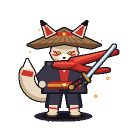
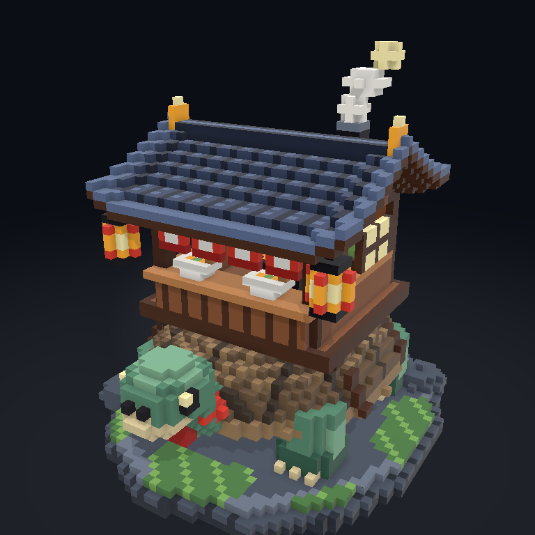
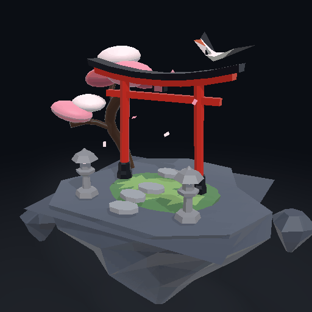
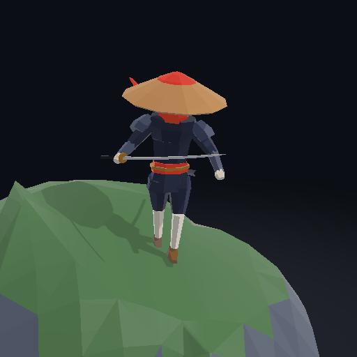
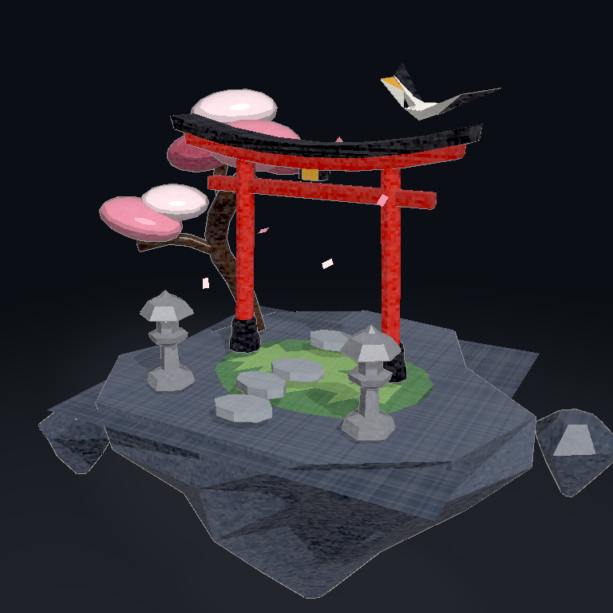
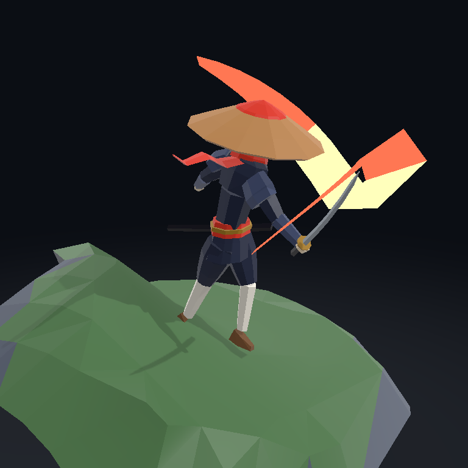
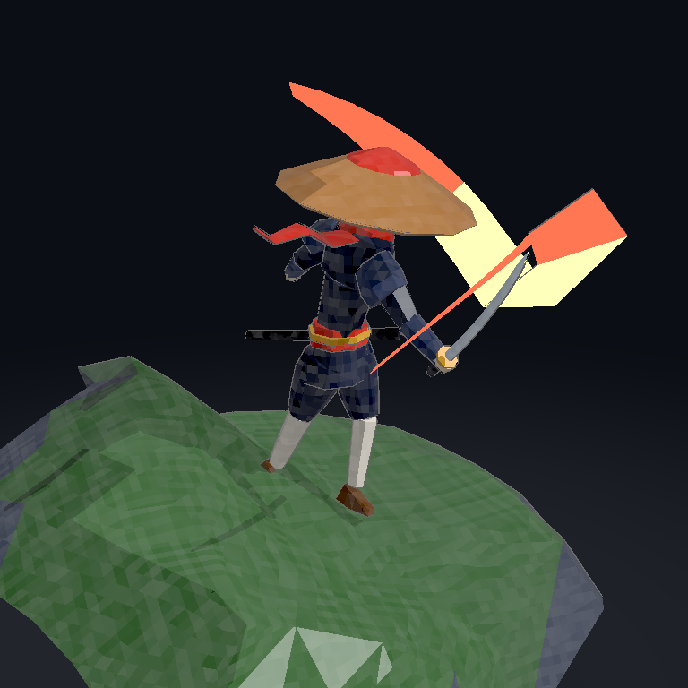

<div align="center">

# TESSEL

**AI-First 2D & 3D Asset Studio in Pure Rust**  
Create **Pixel**, **Voxel**, **Low-Poly**, and **Rigged Character Animations** — preview in **PBR** or **NPR / *Sumi-e*** — and export **`.glb`** with engine scale presets.

[](./LICENSE)
[](https://www.rust-lang.org/)
[](#quick-start)
[](#download--install)

[**Download Latest Release**](https://github.com/five-zombie/tessel/releases/latest) • [**Showcase Gallery**](#-showcase-gallery-included-examples) • [**Available Features**](#-available-features) • [**Quick Start**](#-quick-start)

</div>

---

## 🎨 Showcase Gallery (Included Examples)

The assets below are included in the repo and **bundled directly in the Welcome screen** — click any example on launch to explore, animate, or export as your own copy.

<table>
  <tr>
    <td align="center" width="50%">
      <br/>
      <strong>Ronin Fox — Pixel Mode</strong><br/>
      <sub>256×256 • 3 layers • 4-frame idle @ 8 FPS • GIF &amp; sprite sheet</sub><br/>
      <a href="examples/pixel-ronin-fox/ronin_fox_256.tessel">.tessel</a> •
      <a href="examples/pixel-ronin-fox/ronin_fox_256_sheet.png">sprite sheet</a>
    </td>
    <td align="center" width="50%">
      <br/>
      <strong>Kame-Yatai — Voxel Mode</strong><br/>
      <sub>19,166 voxels • Greedy Meshing + AO • Real Shadows • 360° turntable</sub><br/>
      <a href="examples/voxel-ramen-tortoise/kame_yatai_turntable.gif">360° gif</a> •
      <a href="examples/voxel-ramen-tortoise/kame_yatai_voxel.tessel">.tessel</a> •
      <a href="examples/voxel-ramen-tortoise/kame_yatai_voxel.vox">.vox</a> •
      <a href="examples/voxel-ramen-tortoise/kame_yatai_voxel.glb">.glb</a>
    </td>
  </tr>
  <tr>
    <td align="center" width="50%">
      <br/>
      <strong>Floating Torii Sky-Shrine — Low-Poly</strong><br/>
      <sub>Terrain + Loft + Lathe + Curve Tube + Smart Material AO</sub><br/>
      <a href="examples/lowpoly-sky-shrine/sky_shrine_lowpoly.tessel">.tessel</a> •
      <a href="examples/lowpoly-sky-shrine/sky_shrine_lowpoly.glb">.glb</a>
    </td>
    <td align="center" width="50%">
      <br/>
      <strong>Ronin Iaijutsu — Character Animation</strong><br/>
      <sub>19-bone rig • CubicBezier + 12 FPS stepped • Grounding v2 • Slash VFX</sub><br/>
      <a href="examples/lowpoly-ronin-iaijutsu/ronin_iaijutsu.tessel">.tessel</a> •
      <a href="examples/lowpoly-ronin-iaijutsu/ronin_iaijutsu.glb">.glb</a>
    </td>
  </tr>
</table>

### Dual Viewport Rendering: PBR Studio & Native NPR / *Sumi-e* Ink-Wash

<table>
  <tr>
    <td align="center" width="25%">
      <br/>
      <sub>Sky-Shrine (PBR)</sub>
    </td>
    <td align="center" width="25%">
      <br/>
      <sub>Sky-Shrine (NPR Sumi-e)</sub>
    </td>
    <td align="center" width="25%">
      <br/>
      <sub>Iaijutsu (PBR + Shadows)</sub>
    </td>
    <td align="center" width="25%">
      <br/>
      <sub>Iaijutsu (NPR Sumi-e)</sub>
    </td>
  </tr>
</table>

---

> ### 🤖 AI-First & MCP-First Architecture
> - **MCP is the primary workflow:** Tessel is built **AI-first**, where objects, terrains, rigs, materials, and animations are created primarily via **MCP (Model Context Protocol)**. Because development prioritizes MCP capabilities first, some tools may not yet be exposed directly in the GUI or may still be maturing in the UI — while **MCP can already execute them end-to-end**.
> - **MCP (Verified First-Tier) vs. Embedded Direct AI (Experimental):** Using Tessel's **embedded Direct AI** prompting panel without an external AI agent CLI (such as **Codex CLI**, **Claude CLI**, or **AGY CLI**) may not yet be mature as it has not been thoroughly tested. **MCP is the verified first-tier path**, primarily tested and validated with **Gemini Neon** and **Muse Spark 1.3**.

---

## 📦 Download & Install

Grab the prebuilt native installer or portable binary for your OS from [**GitHub Releases**](https://github.com/five-zombie/tessel/releases/latest):

| Platform | Packages Available | GPU Backend (`wgpu`) |
| --- | --- | --- |
| **Linux (`x86_64`)** | `.deb` (Debian / Ubuntu / Mint), `.rpm` (Fedora / RHEL / openSUSE), `.tar.gz` | Vulkan / OpenGL / Software fallback |
| **Windows (`x86_64`)** | `.exe` standalone, `.zip` portable | DirectX 12 / Vulkan / WARP |
| **macOS (Universal)** | `.dmg` (`Tessel.app`, Apple Silicon + Intel), `.tar.gz` | Metal |

Every release includes `SHA256SUMS.txt` checksums.

---

## ✨ Available Features

- **MCP-First Studio Engine (138 Verified Tools)**:
  - Deterministic Command Bus exposed via `stdio`, live GUI HTTP (`127.0.0.1` with bearer-token auth & `/health` latency telemetry), and headless `tessel batch` CLI runner with atomic batching and full Undo/Redo.
- **4 Integrated Creative Modes**:
  - **Pixel**: Up to `512×512` multi-layer 2D sprite & texture studio with frame-by-frame animation, onion skinning, flood fill, X/Y symmetry, `.png` / `.gif` / sprite sheet export, and **Pixel → Voxel** conversion.
  - **Voxel**: Sparse chunked 3D voxel engine with **Greedy Meshing**, per-vertex Ambient Occlusion, 3D DDA raycast picking, X/Y/Z symmetry, `.vox` import/export, and **Voxel → Low-Poly** conversion.
  - **Low-Poly & Texturing**: Procedural **terrain generator** (`mesh_create_terrain`), `loft`, `lathe`, `curve_tube`, `extruded_polygon`, primitives, CPU map baking (**AO, Curvature, Thickness**), **Smart Material Lite** (edge wear + cavity dirt), non-destructive paint layers, seam-crossing 3D brush, PBR + normal maps, and extended texture decoding (`PNG`, `JPEG`, `TGA`, `TIFF`, `EXR`).
  - **Character & Kinematic Animation v2**: 19-bone humanoid & multi-rig skeletons, auto-skinning with per-node bone masks, analytic **two-bone IK** & multi-bone **CCD chain IK**, multi-track animation (`BoneChannel` SLERP, `CubicBezier` / `CUBICSPLINE`, `MorphWeightTrack`, `VisibilityTrack` `STEP`, `ParentSwitchTrack` for dynamic prop drops, `NodeTransformTrack`), **12 FPS *stepped* playback & bake**, multi-layer clip baking, and **Surface-Raycast Grounding v2** (overhangs, multi-surface `LowPolyMesh` + `VoxelVolume`, heel+toe multi-ray footprints, foot normal alignment, pelvis tilt).
- **Real-Time Shadows & NPR / *Sumi-e* Pipeline**:
  - **2048×2048 Directional Shadow Map** with *normal-offset bias*, 3×3 PCF, and per-mesh `cast_shadow`/`receive_shadow`.
  - **NPR / *Sumi-e* Foundation & Preview**: `COLOR_0` vertex colors, `AlphaMode::Opaque`/`Mask`/`Blend`, `KHR_materials_unlit`, baked smooth outline normals, `mesh_validate_topology`, automatic UV gutter dilation, `outline_hull.wgsl` inverted-hull outlines, 3-band ink ramp, dark Fresnel rim, triplanar *washi* paper grain, depth ink-fade, Orthographic/Telephoto camera modes, and `silhouette_check` / `luminance_value_check` modes.
- **Built-In Welcome Showcase & Export**:
  - **Welcome to Tessel** launcher ships with all 4 embedded `.tessel` examples (with live thumbnails) that always open as safe untitled copies.
  - Export to **`.glb`** (engine scale presets for Godot 4, Unity, Unreal Engine, Three.js, 3D Print), `.obj`, `.stl`, `.vox`, `.png`, `.gif`, 3D animated turntable `.gif`, and atomic `.tessel` archives — with an OS-native default output directory (`<home_dir>/tessel-project`) and folder browser.

---

## 🗺️ Next Features

- **GUI Feature Parity**: Bringing more direct interactive UI controls to match the 138-tool MCP surface.
- **Embedded Direct AI Hardening**: End-to-end testing and stabilization of the in-app Direct AI prompting panel alongside external agent CLIs.
- **Extended NPR Polish**: Optional custom Face SDF Shadow Map & MatCap texture slots, multi-level hatching ramps, and 4× MSAA viewport targets.

---

## 🚀 Quick Start

### Run Desktop Studio from Source
```bash
cargo run --release -p tessel-app
```

- `1` / `2` / `3` / `4`: Switch between Pixel, Voxel, Low-Poly, and Character modes
- `Ctrl/Cmd + K`: Open Command Palette
- `Ctrl/Cmd + E`: Open Export Dialog (`.glb` & multi-format)
- `Ctrl/Cmd + S` / `Ctrl/Cmd + O`: Save / Open `.tessel` project
- `Ctrl/Cmd + Z` / `Ctrl/Cmd + Y`: Undo / Redo

### Connect an AI Agent via MCP
- **Live GUI HTTP MCP**: Click the `MCP` pill in the top toolbar to start the local server (`http://127.0.0.1:<port>/mcp`) and copy the bearer-token JSON config directly into **Codex CLI**, **Claude CLI**, or **AGY CLI**.
- **Headless `stdio` MCP Server**:
  ```bash
  cargo run --release -p tessel-app -- mcp --export-dir ./exports
  ```

### Verify Build & Tests
```bash
cargo fmt --check
cargo clippy --workspace --all-targets -- -D warnings
cargo test --workspace
```

---

## 🗂️ Workspace Structure

```text
tessel/
├── assets/shaders/         # WGSL shaders (grid, ground_shadow, shadow_depth, mesh_3d, outline_hull, pixel_2d, overlay)
├── examples/               # Bundled Pixel, Voxel, Low-Poly, and Character Animation showcases
└── crates/
    ├── tessel-core/        # Headless domain engine, meshing, baking, rigging, IK, grounding & Command/Undo Bus
    ├── tessel-io/          # .glb, .obj, .stl, .vox, .png, .gif & atomic .tessel project I/O
    ├── tessel-render/      # wgpu 2D/3D PBR + NPR Sumi-e viewport, real shadow maps & overlay pipeline
    ├── tessel-ai/          # Direct AI client, 138-tool MCP Server (stdio + local HTTP) & headless renderer
    └── tessel-app/         # Desktop GUI (winit + egui), Welcome showcase & CLI entrypoint
```

---

## 🧠 AI Model Notes

- This project is built and primarily verified via MCP with **Gemini Neon** and **Muse Spark 1.3**.
- For generating **Low-Poly** assets via MCP, **Gemini Neon** delivers better results overall. **Muse Spark 1.3** works well for inanimate objects and props (such as backpacks or hard-surface items), but is not recommended for living/organic subjects such as animals or human characters.

---

## Third-Party Notices

- **Phosphor Icons** (toolbar & UI glyphs, via the `egui-phosphor` crate) — Copyright Helena Zhang and Tobias Fried, [MIT License](https://github.com/phosphor-icons/home/blob/main/LICENSE). Glyph names and codepoints © their authors.

---

## License

Copyright 2026 **The Five Zombie Org**

Licensed under the [Apache License, Version 2.0](./LICENSE).
